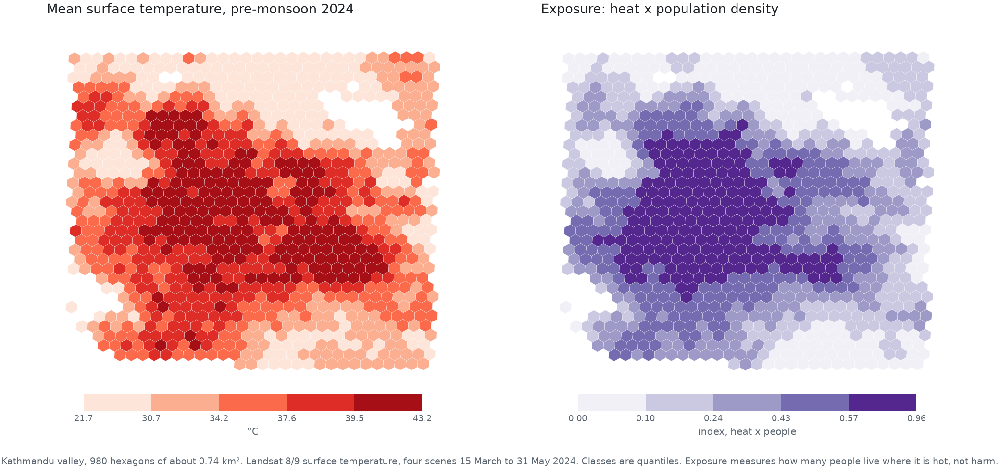
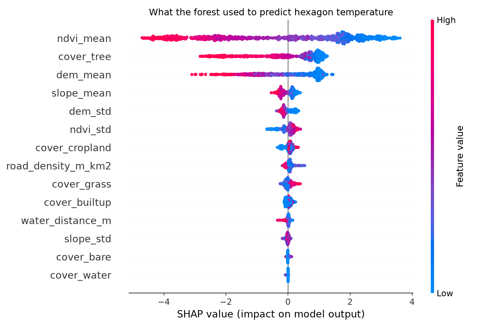

# Kathmandu urban heat GeoAI

Which neighbourhoods of the Kathmandu valley run hottest in the pre-monsoon season,
what land-surface features go with that heat, and where do the hot areas overlap with
dense population?

The valley is split into H3 resolution 8 hexagons of roughly 0.74 km2. Each hexagon
gets a mean land surface temperature from Landsat 8/9, plus greenness, elevation,
slope, land-cover shares and population. A Random Forest learns which features go with
hot hexagons, tested with spatial cross-validation so that whole blocks stay unseen.
The hot and densely populated hexagons are then shown on an interactive map.

This is a descriptive study of one season in one valley. It does not forecast
temperature, and it does not show that any feature causes heat.

**[Open the interactive map](https://abiralgtm.github.io/urban-heat-geoai/)**



## Pipeline

| Stage | Script | Output |
| --- | --- | --- |
| 1. Grid | `src/01_make_grid.py` | `data/processed/kathmandu_grid.gpkg` |
| 2. Satellite data | `gee/heat_kathmandu.js` | 7 rasters in `data/raw/kathmandu/` |
| 3. Features | `src/03_raster_features.py` | `data/processed/features.csv` |
| 4. OSM (optional) | `src/04_osm_features.py` | road density, waterway distance |
| 5. Model | `src/05_model.py` | `outputs/metrics.json`, SHAP plot |
| 6. Vulnerability and map | `src/06_export_web.py` | `docs/data/kathmandu.geojson` |
| 7. Figures | `src/07_figures.py` | `docs/images/` |

Every stage reads `config.yaml` and the output of the stage before it, so any stage can
be re-run on its own.

## Data sources

| Layer | Dataset | Native resolution | Used for |
| --- | --- | --- | --- |
| Surface temperature | Landsat 8/9 Collection 2 Level 2, band `ST_B10` | about 100 m, resampled to 30 m | model target |
| Greenness (NDVI) | Landsat 8/9 surface reflectance, bands `SR_B4`, `SR_B5` | 30 m | feature |
| Elevation, slope | Copernicus DEM GLO30 | 30 m | features |
| Land cover | ESA WorldCover v200 (2021) | 10 m, exported at 30 m | share of each class |
| Population | WorldPop GP 100 m, Nepal 2020 | about 93 m | exposure index only |
| Roads, waterways | OpenStreetMap via osmnx | vector | features |

Population is held out of the model on purpose, so that the model cannot reach the
target through the same people it is later used to count.

## Satellite data

`gee/heat_kathmandu.js` runs in the Earth Engine Code Editor and writes the rasters to
Drive; download them into `data/raw/kathmandu/`.

Scene selection: Landsat 8 and 9 Collection 2 Level 2, 15 March to 31 May 2024, scene
cloud cover under 30 %. Four scenes pass that filter over the valley (14 April,
30 April, 16 May, 24 May 2024). Per-pixel cloud, cloud shadow, cirrus and saturation are
masked with `QA_PIXEL` and `QA_RADSAT` before compositing, and the composite is the
median of the four scenes, so one bad pixel in one scene cannot pull it.

Seven rasters are exported: `lst`, `ndvi`, `dem`, `slope`, `worldcover`, `pop_density`
and `valid_share`. The last is the fraction of the four scenes for which each pixel
survived the mask, and stage 3 uses it to drop hexagons that are mostly gap.

Surface temperature comes from band `ST_B10` converted to degrees Celsius
(`ST_B10 * 0.00341802 + 149.0 - 273.15`). It is a daytime skin temperature at roughly
10:30 local time with a native thermal resolution of about 100 m, not air temperature
and not what a person feels.

## Setup

```bash
python -m venv .venv && source .venv/bin/activate
pip install -r requirements.txt
```

## Results

980 hexagons survive the quality filter out of 1,032 in the study box; 52 are dropped
for covering less than 60 % of the four Landsat scenes. Mean surface temperature across
them runs from 21.7 to 43.2 °C, averaging 35.0 °C.

A Random Forest (500 trees, `min_samples_leaf` 2, `max_features` 0.5) predicts a
hexagon's mean temperature from 14 features. Every number below is the mean over three
seeds of a 5-fold cross-validation, with the spread over seeds in brackets.

| Cross-validation | R² | RMSE |
| --- | --- | --- |
| Random folds | 0.950 (± 0.001) | 1.07 °C (± 0.004) |
| Spatial folds, H3 resolution 6 blocks | 0.900 (± 0.000) | 1.21 °C (± 0.002) |

The gap of 0.051 in R² is the point of running both. Random folds put a hexagon's
immediate neighbours in the training set, which is close to testing on the training
data; the spatial folds hold out whole blocks of about 36 hexagons, so the test areas
are genuinely unseen. The spatial score is the honest one.

Ranked by mean absolute SHAP value, in °C of effect on the prediction:

| Feature | Mean absolute SHAP |
| --- | --- |
| NDVI (greenness) | 2.08 |
| Tree-cover share | 0.93 |
| Elevation | 0.90 |
| Slope | 0.19 |
| Elevation spread within the hexagon | 0.15 |

Greenness dominates, and built-up share and road density add little once greenness is
known — they largely say the same thing about a hexagon. Elevation matters because the
valley floor is both the warmest and the most built-up part of the study box, so the two
cannot be separated with this design.



Exposure, the heat index times normalised log population density, puts 98 hexagons in
the top decile. The [interactive map](https://abiralgtm.github.io/urban-heat-geoai/)
shows both layers, with the per-hexagon numbers in a popup.

## Limits

- Four scenes, one pre-monsoon season, one year. Nothing here describes another season
  or a trend over time.
- Landsat's thermal band is about 100 m natively and the overpass is near 10:30 in the
  morning. This is daytime skin temperature, not air temperature and not what a person
  feels, and it says nothing about night-time heat.
- The model describes patterns in this valley. It is not a forecast, and no feature here
  is shown to cause heat; features that travel together cannot be separated.
- Elevation and built-up land are confounded in the Kathmandu valley, so their
  contributions should not be read separately.
- The exposure index measures how many people live where it is hot. It does not measure
  harm, and it carries nothing about age, income, housing or access to cooling.
- WorldPop is a modelled estimate. Its totals over this box come to 7.7 million people,
  well above the census figure for the valley, so the population numbers are used only
  as a relative, normalised layer and should not be quoted as counts.
- Spatial cross-validation uses 27 blocks, which is a small number of groups; the fold
  scores are correspondingly coarse.
- A first attempt at a flood-extent project was dropped: Sentinel-1 had no usable image
  at the September 2024 flood peak, so there were too few flood labels to learn from.


## Reproducing

```bash
python src/01_make_grid.py          # H3 grid over the study box
# run gee/heat_kathmandu.js in the Earth Engine Code Editor,
# then put the exported .tif files in data/raw/kathmandu/
python src/03_raster_features.py    # zonal statistics per hexagon
python src/04_osm_features.py       # OpenStreetMap features, --skip to leave them out
python src/05_model.py              # cross-validation, SHAP, metrics
python src/06_export_web.py         # vulnerability index and GeoJSON
python src/07_figures.py            # the two figures above
python -m http.server --directory docs   # view the map at localhost:8000
```

The rasters, the grid and the feature table are not committed; the scripts rebuild them.
`outputs/metrics.json` and `outputs/exposure_summary.json` are committed, so the numbers
in this README can be checked against the run that produced them.

## License

MIT, see `LICENSE`. The data belongs to its providers: Landsat (USGS, public domain),
Copernicus DEM (ESA), ESA WorldCover (CC BY 4.0), WorldPop (CC BY 4.0) and
OpenStreetMap (ODbL).
